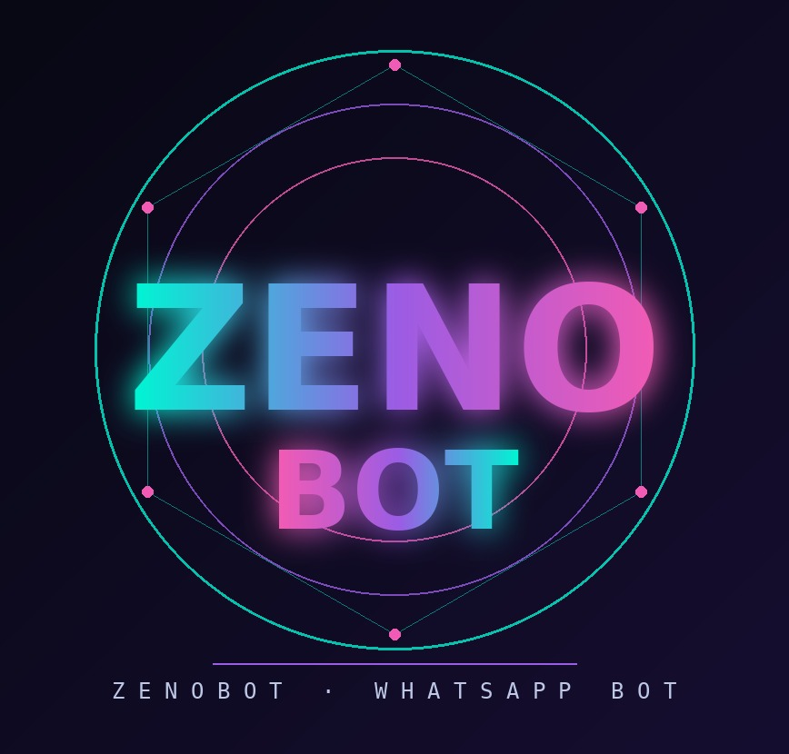

<div align="center">

# ◈ ᴢᴇɴᴏʙᴏᴛ

**ʙᴏᴛ ᴡʜᴀᴛꜱᴀᴘᴘ ɪɴ ɴᴏᴅᴇ.ᴊꜱ — ᴠ10.3**



</div>

┌┄┄┄┄┄┄┄┄┄┄┄┄┄┄┄┄┄┄┄┄┄┐
┆ ❖ ɪɴꜱᴛᴀʟʟᴀᴢɪᴏɴᴇ
└┄┄┄┄┄┄┄┄┄┄┄┄┄┄┄┄┄┄┄┄┄┘

```bash
git clone https://github.com/Yervinboss/bho zenobot
cd zenobot
npm install
npm start
```

All'avvio scegli il collegamento: **1** QR code oppure **2** codice a 8 caratteri.
Requisiti: Node.js 18+ (consigliato 20+), `git`, `ffmpeg`.

┌┄┄┄┄┄┄┄┄┄┄┄┄┄┄┄┄┄┄┄┄┄┐
┆ ❖ ꜱᴛʀᴜᴛᴛᴜʀᴀ
└┄┄┄┄┄┄┄┄┄┄┄┄┄┄┄┄┄┄┄┄┄┘

| Percorso | Contenuto |
|---|---|
| `index.js` | avvio e schermata di boot |
| `zenobot.js` | connessione a WhatsApp e caricamento plugin |
| `handler.js` | gestione messaggi e comandi |
| `config.js` | nome bot, owner, impostazioni |
| `plugins/` | tutti i comandi (admin, giochi, RPG, owner, info) |
| `zenobotSubbot/` | gestione sub-bot |
| `icone/` | immagini usate nei menu (logo: `zenobot.jpg`) |

Il menu si apre con `.menu`. Valuta del bot: **ZenoCoin**.

Licenza: Apache-2.0
